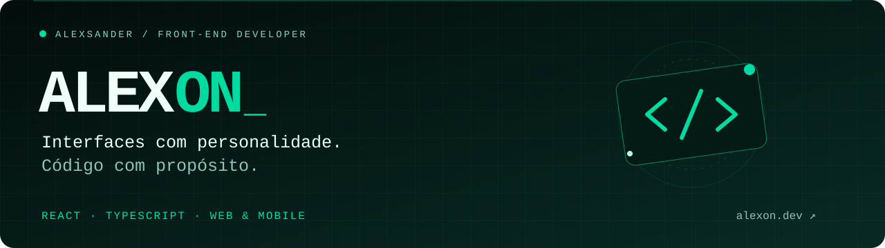

<!-- Perfil de Alexsander Albino • AlexOnn1 -->

  

<h1 align="center">Olá, eu sou o Alexsander Albino 👋</h1>

  <strong>Desenvolvedor Front-End · Web &amp; Mobile</strong> 
  De Maceió, AL, para a próxima ideia que merece sair do papel.

  <a href="https://alexon.dev"><strong>Portfólio ↗</strong></a>
  &nbsp; / &nbsp;
  <a href="https://www.linkedin.com/in/alexsander-albino-dev">LinkedIn</a>
  &nbsp; / &nbsp;
  <a href="mailto:alexsander.santos.contato@gmail.com">Vamos conversar</a>

---

### Uma boa interface começa entendendo quem vai usar.

Sou estudante de **Ciência da Computação** e desenvolvedor com foco em **React, TypeScript e experiência do usuário**. Gosto de transformar ideias em interfaces que fazem sentido na prática: organizar uma partida, montar um pedido ou apresentar o trabalho de alguém.

Minha trajetória também passa pelo ensino de programação. Explicar conceitos, ouvir dúvidas e acompanhar o aprendizado faz parte de como penso sobre tecnologia: clareza importa tanto na tela quanto no código.

**[Conheça meu portfólio em Alexon.dev →](https://alexon.dev)**

## Projetos selecionados

Uma seleção do que venho construindo, dos desafios de produto às decisões de implementação.

<table>
<tr>
<td width="50%" valign="top">

### 🍕 Fatia$
**O rodízio virou uma experiência multiplayer.**

Calculadora de custo por fatia com salas para amigos, ranking ao vivo e pódio compartilhável.

**No código:** sincronização com Firebase Realtime Database e alternativa local com BroadcastChannel + localStorage.

`React` `TypeScript` `Firebase` `CSS Modules`

<a href="https://fatias.vercel.app"><strong>Experimentar ↗</strong></a> · <a href="https://github.com/AlexOnn1/fatia-">Ver código</a>

</td>
<td width="50%" valign="top">

### ⚽ Bora Rachar
**Menos discussão nos times. Mais bola em campo.**

Aplicativo para cadastrar jogadores, distribuir times por nível e acompanhar placar e cronômetro.

**Minha contribuição:** front-end e liderança técnica no projeto acadêmico em equipe. Sorteio com Snake Draft e persistência local com AsyncStorage.

`React Native` `Expo` `TypeScript`

<a href="https://bora-rachar-seven.vercel.app"><strong>Experimentar ↗</strong></a> · <a href="https://github.com/AlexOnn1/Bora-Rachar">Ver código</a>

</td>
</tr>
<tr>
<td width="50%" valign="top">

### 🦁 O Leãozinho
**Do cardápio ao pedido em um só fluxo.**

Protótipo de plataforma para lanchonete com categorias, controle de quantidade, carrinho lateral e finalização pelo WhatsApp.

**No código:** estado do carrinho com Context + useReducer, componentes reutilizáveis e estilos isolados.

`React` `TypeScript` `Vite` `CSS Modules`

<a href="https://github.com/AlexOnn1/leaozinho-prototipo-app"><strong>Explorar o projeto →</strong></a>

</td>
<td width="50%" valign="top">

### ✦ SIEG
**Um palco digital para quem trabalha com movimento.**

Portfólio para um motion designer, com galeria de trabalhos, estudos e páginas de projetos com vídeos.

**No código:** HTML semântico, layouts responsivos e organização de conteúdo para apresentar a identidade e o trabalho do cliente.

`HTML` `CSS` `Vimeo`

<a href="https://siegvfx.com"><strong>Visitar site ↗</strong></a> · <a href="https://github.com/AlexOnn1/Sieg">Ver código</a>

</td>
</tr>
</table>

<strong>Mais um projeto para explorar: Sistema de Vendas em Python</strong>

 

Simulação de compra com carrinho, limite de estoque e parcelamento com cálculo de juros. Um projeto de estudo para conectar lógica de negócio, estado de sessão e interface com **Python + Streamlit**.

[Explorar o repositório →](https://github.com/AlexOnn1/Sistema-de-vendas)

## Minha caixa de ferramentas

| Onde atuo | Tecnologias e práticas |
| :--- | :--- |
| **Interfaces web** | React · TypeScript · JavaScript · HTML · CSS · CSS Modules · Sass · Tailwind CSS |
| **Experiências mobile** | React Native · Expo · Expo Router · AsyncStorage |
| **Estado e integração** | Context API · useReducer · Firebase Realtime Database |
| **Do design à entrega** | Figma · Git · GitHub · Vite · Layouts responsivos |
| **Além do front-end** | Python · Streamlit · PHP |

## O que conecta meus projetos

- **Uso real como ponto de partida.** Cada interface nasce de uma situação concreta.
- **Detalhes que ajudam a navegar.** Hierarquia visual, feedback de ações e fluxos claros.
- **Código que permite evoluir.** Componentes reutilizáveis, tipagem e responsabilidades organizadas.

---

  <strong>Tem uma ideia que merece uma boa interface?</strong> 
  Vamos transformar a próxima em projeto.

  <a href="https://alexon.dev"><strong>Alexon.dev ↗</strong></a>
  &nbsp; · &nbsp;
  <a href="mailto:alexsander.santos.contato@gmail.com">alexsander.santos.contato@gmail.com</a>

